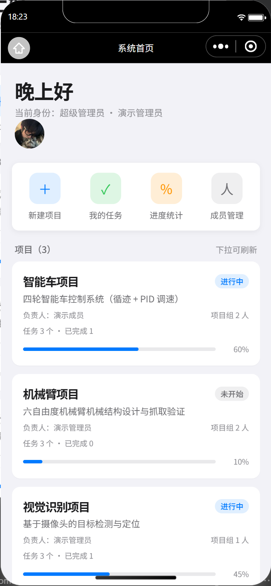
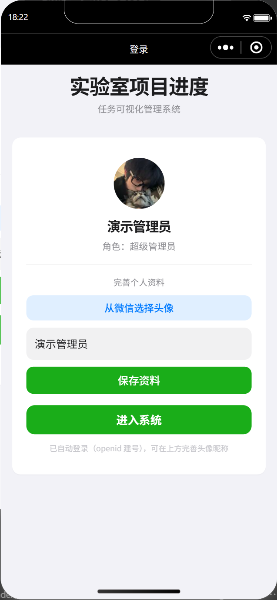
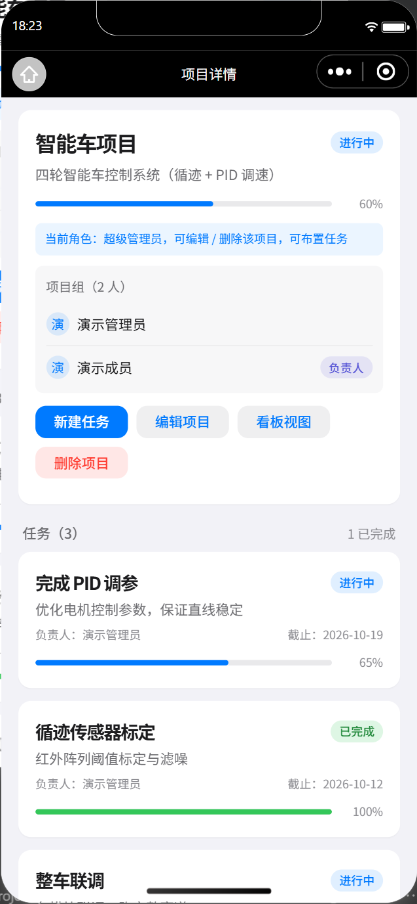
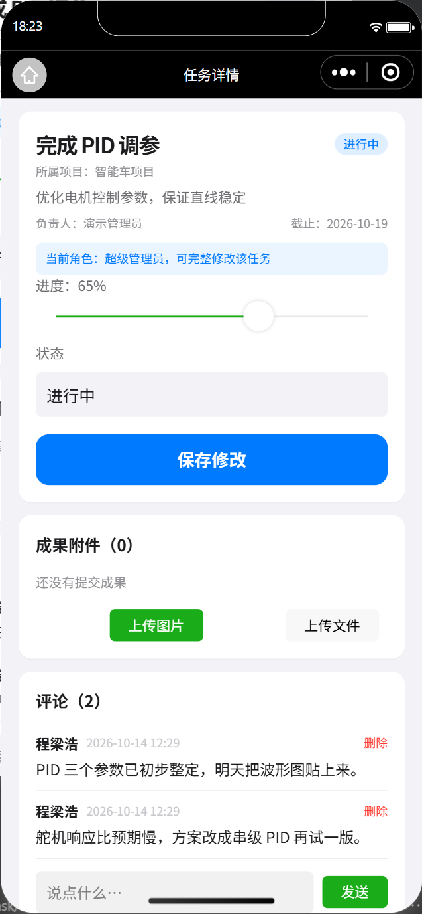
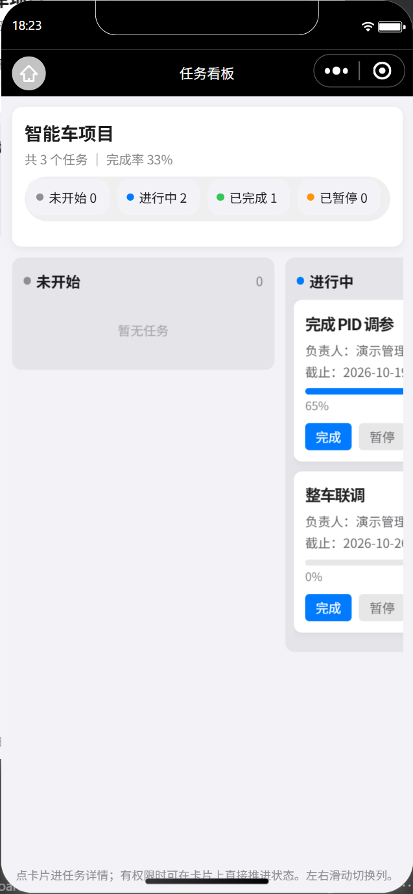
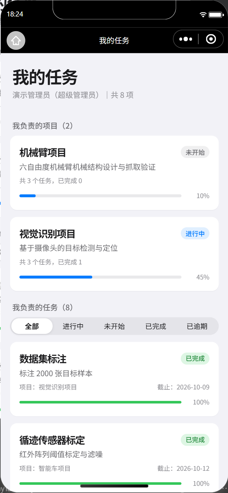
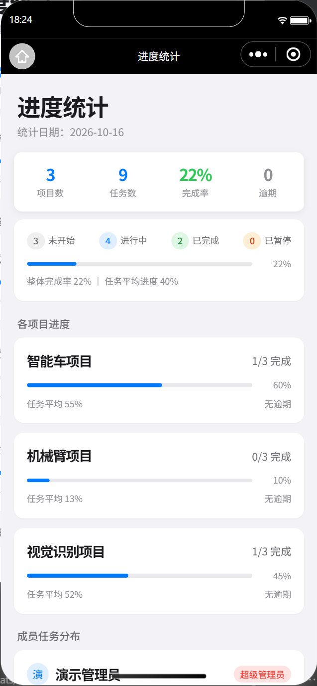
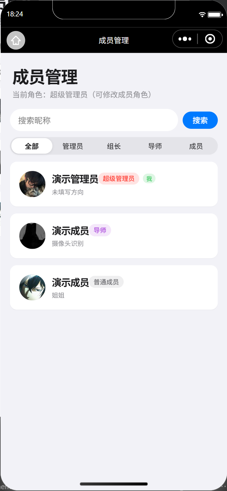
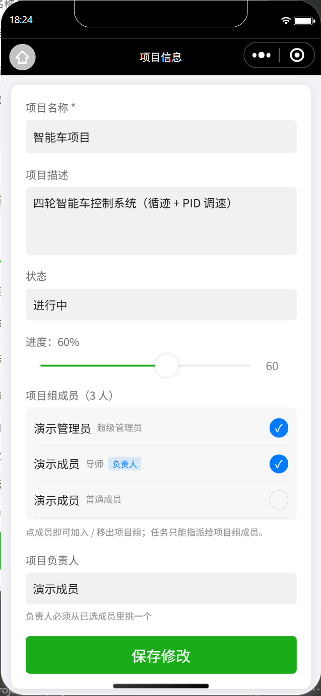

# 实验室项目进度管理系统

> 基于 **微信小程序 + 云开发（CloudBase）** 的实验室／课题组项目进度管理系统。
> 支持项目组、任务指派、成果附件、评论、看板、进度统计，带四级权限体系。
> 可直接当作模板，改造成你自己的团队协作工具。



---

## 功能

| 模块 | 能力 |
|---|---|
| **登录与身份** | 微信静默登录自动建号、`chooseAvatar` 头像、昵称填写、**第一个登录的用户自动成为管理员** |
| **注册审核（准入）** | 小程序上线后任何人都能搜到，所以新用户默认是**待审核**：只能填申请（真实姓名 / 学号 / 说明），看不到任何项目与任务；**导员或管理员审核通过**后才能进入。可拒绝（本人可改后重提）、可禁用 |
| **四级权限** | 超级管理员 / 导师 / 组长 / 普通成员，前端控制按钮显隐 + **云函数侧独立二次校验** |
| **项目** | 新建 / 编辑 / 删除（级联删任务）、状态与进度、项目组（多成员 + 其中一人任负责人） |
| **任务** | 布置 / 指派（**只能指派给项目组成员**）/ 截止日期 / 状态 / 进度 / 逾期标红 |
| **成果** | 任务成果附件（图片与文件）、缩略图、点击预览或打开、删除；附件读权限通过云函数换临时链接解决 |
| **评论** | 任务下评论，作者或管理者可删 |
| **看板** | 四列状态看板（未开始/进行中/已完成/已暂停），卡片上直接推进状态，横向滑列 |
| **我的任务** | 我负责的项目 + 指派给我的任务，筛选 / 逾期提醒 |
| **进度统计** | 总览指标、状态分布、按项目、按成员 |
| **成员管理** | 列表 / 搜索 / 角色筛选 / 改角色 / 改资料 |
| **成员归档（毕业交接）** | 毕业生可**归档**（软删除）：从成员列表、指派下拉、统计里隐藏，历史数据不断链；归档前**强制逐项移交**他负责的项目与未完成任务；可随时恢复 |
| **数据导出 / 备份** | 管理员一键导出 JSON（含昵称→openid 映射表与附件清单），用于备份或**换主体迁移** |
| **UI 设计层** | 统一设计层（iOS 风格）：状态色卡、卡片、徽章、进度条、按钮、骨架屏、吸顶毛玻璃标题栏 |

---

## 截图

| 登录 | 首页 | 项目详情 |
|---|---|---|
|  |  |  |

| 任务详情 | 看板视图 | 我的任务 |
|---|---|---|
|  |  |  |

| 进度统计 | 成员管理 | 项目编辑 |
|---|---|---|
|  |  |  |

---

## 技术栈

- **前端**：uni-app + Vue3（用 HBuilderX 编译）
- **后端**：微信云开发 —— 云函数（Node.js）+ 云数据库 + 云存储
- **数据库**：3 个集合 `users` / `projects` / `tasks`，权限设为**自定义安全规则**（客户端不可直连，一切走云函数）
- **不含**任何 UI 组件库与第三方依赖，云函数只依赖 `wx-server-sdk`

---

## 目录结构

```
.
├── lab-progress/                     uni-app 前端源码
│   ├── pages/                        页面（详见下表）
│   ├── utils/
│   │   ├── config.js                 ★ 唯一需要你改的配置（云环境 ID / AppID）
│   │   ├── api.js                    云函数统一调用层（loading / 错误 / 成功提示）
│   │   └── perm.js                   登录态与权限缓存
│   ├── App.vue                       ★ 全局样式 = 设计层（色板 / 卡片 / 徽章 / 骨架屏…）
│   ├── main.js                       云开发初始化
│   ├── pages.json                    页面注册
│   └── manifest.json                 小程序配置（AppID 写这里）
├── cloudfunctions/                   云函数（每个函数一个目录）
├── docs/
│   ├── screenshots/                  README 截图
│   ├── 上架前检查清单.md
│   ├── 数据库安全规则.md
│   └── 真机多角色验收清单.md
├── 交接文档.md                        ★ 开发笔记：架构 / 权限 / 踩坑 / 规范（强烈建议先读）
└── LICENSE
```

页面清单：`index`(登录) · `home`(首页) · `project`(项目详情) · `projectEdit`(项目编辑) · `task`(任务详情) · `taskEdit`(任务编辑) · `board`(看板) · `myTasks`(我的任务) · `stats`(进度统计) · `member`/`memberDetail`(成员) 

---

## 快速开始

### 0. 前置

- 一个**微信小程序 AppID**（[申请](https://mp.weixin.qq.com/)）
- [HBuilderX](https://www.dcloud.io/hbuilderx.html)（用于编译 uni-app）
- [微信开发者工具](https://developers.weixin.qq.com/miniprogram/dev/devtools/download.html)（用于云开发与上传）

### 1. 开通云开发

微信开发者工具 → 云开发 → 新建环境，记下**环境 ID**（形如 `cloud1-xxxxxxxx`）。

### 2. 新建数据库集合

云开发控制台 → 数据库 → 新建 3 个集合：`users`、`projects`、`tasks`。

然后**逐个把权限改成自定义安全规则**（默认权限会让客户端能直接读写数据库，不安全）：

```json
{ "read": false, "write": false }
```

### 3. 配置

改 `lab-progress/utils/config.js`：

```js
export const CLOUD_ENV = '你的云环境ID'
export const APPID = '你的小程序AppID'
```

改 `lab-progress/manifest.json` → `mp-weixin.appid` = 你的 AppID。

### 4. 部署云函数

微信开发者工具打开**仓库根目录**（根目录的 `project.config.json` 里配了 `cloudfunctionRoot`），
然后在云开发控制台 → 云函数，逐个右键上传部署；或用 CLI：

```bash
# 把 <函数名> 换成 cloudfunctions/ 下的目录名
微信开发者工具/cli.bat cloud functions deploy -e <你的环境ID> -n <函数名> -r --project <仓库根目录绝对路径>
```

需要部署：`login` `checkPermission` `getProjects` `createProject` `updateProject` `deleteProject`
`getTasks` `getTask` `createTask` `updateTask` `deleteTask` `getMyTasks` `getTaskStats`
`getMembers` `updateMember` `taskExtra`

### 5. 跑起来

HBuilderX 打开 `lab-progress` → 运行到微信小程序模拟器（或按下面的命令行）。

**第一个扫码登录的用户会自动成为管理员**，之后可以在「成员管理」里给别人分配角色。

之后任何人打开小程序都会先看到**「申请加入」页**（填真实姓名 / 学号 / 申请说明），
需要你在首页「注册审核」里点「通过」才能进入系统 —— 这是为"小程序上线后谁都能搜到"准备的准入机制。
如果只是想自己一个人用，直接通过自己即可。

> ⚠️ 上线（发布正式版）前请确认至少有一个 `admin` 账号且状态是 `active`，否则没人能审核。

---

## 云函数一览

| 云函数 | 作用 | 权限 |
|---|---|---|
| `login` | 静默登录 / 建号（首个用户自动为 admin；新用户 `status=pending` 待审核） | 任何用户 |
| `checkPermission` | 返回角色、权限矩阵、审核状态与 `canReview` | 任何用户 |
| `apply` | **注册申请**：`myStatus` 查自己的审核状态与已填内容 / `submit` 提交或修改后重提 | 任何已登录用户 |
| `review` | **注册审核**：`pendingCount` / `list` / `approve` / `reject` / `block` / `restore` | admin / mentor |
| `getProjects` | 项目列表 / 单项目（含项目组成员姓名、任务数、逾期数） | 已登录 |
| `createProject` / `updateProject` / `deleteProject` | 项目增改删（改项目含调整项目组、换负责人） | admin / mentor / **该项目负责人**；删除仅 admin |
| `getTasks` / `getTask` | 任务列表 / 详情（含项目负责人与成员，供前端判权） | 已登录 |
| `createTask` / `updateTask` / `deleteTask` | 任务增改删；指派对象必须是项目组成员 | admin / mentor / **该项目负责人**；成员可改自己任务的进度与状态 |
| `getMyTasks` | 我的任务 + 我负责的项目 | 已登录 |
| `getTaskStats` | 进度统计（总览 / 按项目 / 按成员） | 已登录 |
| `getMembers` / `updateMember` | 成员列表与详情 / 改角色与资料（默认只返回在职成员） | admin 全部；mentor 仅"组长↔成员" |
| `archiveMember` | **成员归档 / 恢复**：preview（影响清单）/ archive（带移交方案）/ restore / list | 仅管理员；不能归档自己与最后一个管理员 |
| `dataExport` | **数据导出 / 备份**（users+projects+tasks+昵称映射+附件清单） | 仅管理员 |
| `taskExtra` | 成果附件（增删/取临时链接/兜底读内容）+ 评论（增删） | 见下 |

`taskExtra` 的 6 个动作：`addAttachment` `deleteAttachment` `addComment` `deleteComment` `getFileURLs` `getFileBase64`
> 附件上传：任务负责人本人 / admin / mentor / 该项目负责人；评论：任何已登录用户。
> 附件与评论**内嵌在任务文档的数组字段**里（云函数无法自动建集合，所以没开新集合）。

---

## 权限模型

### 第一道门：谁能进系统（注册审核）

| 状态 | 本人看到什么 | 能不能用系统 |
|---|---|---|
| `pending` 待审核 | 申请页（等待审核 / 刷新状态 / 修改申请） | ❌ |
| `rejected` 已拒绝 | 申请页 + 拒绝原因 + 重新提交 | ❌ |
| `blocked` 已禁用 | 申请页（提示联系管理员，不能再申请） | ❌ |
| `active` 已通过 | 正常使用 | ✅ |

- 新用户注册后就是 `pending`；**老账号没有 `status` 字段时按 `active` 处理**，升级不受影响
- 导员（mentor）和管理员（admin）在首页「注册审核」里处理，图标上有待审红点
- **服务端强制**：16 个业务云函数对未通过审核的账号直接返回 `code=PENDING / REJECTED / BLOCKED`，前端只是顺带跳转到申请页
- 例外：**第一个登录的用户**自动 `admin` + `active`（否则刚部署就把自己锁在外面）

### 第二道门：进来之后能做什么

| 角色 | 项目 | 任务 | 成员 | 成果 |
|---|---|---|---|---|
| **admin** 超管 | 建/改/删任意项目、调整任意项目组 | 任意任务增改删与指派 | 改任意人角色（含授予超管） | 任意任务可交 |
| **mentor** 导师 | 建/改项目、调整项目组 | 增改删任务 | 任命"组长↔成员"，不能授予超管 | 任意任务可交 |
| **leader / 项目负责人** | 只能改**自己负责**的项目 | 只能管**自己负责项目**下的任务 | 无 | 只有自己项目里的任务可交 |
| **member** 成员 | 只读 | 只读；可改**自己任务**的进度与状态 | 无 | 只有自己的任务可交 |

三条设计原则：

1. **前端只控制按钮显隐，服务端（云函数）一律独立再校验一次**；前端判断必须用"任务所属项目的负责人"这种**项目级**条件，不能用全局角色位。
2. **数据库三个集合都是 `{read:false, write:false}`**，客户端无法直连数据库。
3. **项目负责人是项目级身份**，与全局角色解耦 —— 谁被设为某项目的负责人，就对那个项目有管理权。

---

## 数据库结构

```
users     { _openid, nickName, avatarUrl, role,
            status,                       // pending | active | rejected | blocked（缺省=active）
            apply{ realName, studentId, reason, time, ts },
            rejectReason, blockReason, reviewedBy, reviewedTime,
            groupId, direction, intro,
            archived, archivedTime, archivedBy, createTime }
projects  { name, description, status, progress, leaderId, memberIds[], creatorId, createTime, updateTime }
tasks     { title, description, projectId, assignUser, deadline, status, progress, creatorId,
            attachments[{ fileID, name, size, uploader, uploaderName, time }],
            comments[{ text, author, authorName, avatarUrl, time }], createTime, updateTime }
```

> `projects.leaderId` 必须在 `projects.memberIds` 里（服务端强制）；
> `tasks.assignUser` 必须来自项目组；
> `users.archived = true` 表示该成员已归档（毕业生），默认不出现在列表/下拉/统计里；
> `users.status` 缺省视为 `active`（兼容升级前的老账号）；
> `apply.ts` 是毫秒时间戳，用于"1 分钟内不能重复提交申请"（**云函数在 UTC，别用字符串算时间差**）。

---

## 毕业交接与长期维护（重要）

这个系统绑定在**你注册小程序的那个主体**上，交接时容易踩坑，先把概念分清：

| 概念 | 限制 | 说明 |
|---|---|---|
| **正式版的使用者** | **无人数上限** | 审核发布后任何微信用户都能用，微信不按人头限制 |
| **体验成员** | 个人主体较少（常见 15 人） | 只给"未发布、内部试用"的名单；十几个人长期用体验版迟早会卡住 |
| **项目成员**（开发者/运营者） | 个人主体同样较少 | 能进后台改代码/发版本的人，适合把师弟加成这个 |
| **云开发配额** | 免费套餐按**资源**算，不按人 | 数据库读写次数、存储、CDN 流量、云函数调用量 |
| **ICP 备案** | 新注册小程序必须备案才能上线 | 在公众平台提交，个人主体也可备案，一般 1~20 天 |

**所以正确的长期方案是：提交审核、发布正式版**（不受体验成员限制），并把下一届同学加成**开发者/运营者**。

### 毕业时怎么把系统交出去

**情况一：小程序继续挂在原主体名下（最省事）**
1. 公众平台 → 成员管理 → 把师弟加成**开发者/运营者**
2. 在成员页把毕业生**归档**（他会自动从列表/下拉/统计里消失，历史数据保留）
3. 把本仓库 + `交接文档.md` 交给实验室留档

**情况二：换成实验室/学院的组织主体（所有权真正转移）**
1. 用组织资质（营业执照/事业单位法人证书）注册新小程序 AppID，开通新云环境
2. 用管理员账号导出数据：跑 `node .devtools/export-data.js`（内部调用 `dataExport` 云函数）
   得到 `data.json`（全量数据）、`nameMap.json`（昵称→openid）、`attachments.json`（附件清单）
3. 在新小程序里让每个人**登录一次**（新 users 表建号）
4. 按 `nameMap.json` 的昵称把「旧 openid → 新 openid」建立映射，用它重写
   `projects.memberIds` / `projects.leaderId` / `tasks.assignUser` /
   `tasks.attachments[].uploader` / `tasks.comments[].author`
5. 附件按 `attachments.json` 从旧环境下载再上传到新环境，替换 fileID

> ⚠️ 换 AppID 后**所有人的 openid 都会变**，所以第 4 步不可跳过；内容数据本身不会丢。
> ⚠️ 个人主体的小程序**不支持主体变更/过户**，所以"把现在的 AppID 转给师弟"这条路是不通的。

---

## 上线说明（发布正式版后怎么管人）

体验版有成员上限，长期使用必须发布正式版；但正式版**谁都能搜到**，所以系统自带准入审核：

1. **上线前**
   - 删掉云函数 `devTools`（有提权能力，`setStatus` 能绕过审核改别人状态）和 `devLog`
   - 确认三集合权限是自定义规则 `{read:false, write:false}`
   - 确认自己的账号是 `admin` 且 `status=active`（成员管理里能看角色）
   - 需要导员一起审核的话，把他角色改成 `mentor`
2. **上线后**
   - 把小程序码/链接发到实验室群，说明"要申请，等审核"
   - 新人打开就是「申请加入」页，填姓名/学号/说明 → 你在首页「注册审核」（有红点）里点通过
   - 通过时可以顺便定角色：普通成员选 `member`，要当项目组长的选 `leader`
3. **日常**
   - 有人毕业：用**成员归档**（不要用「禁用」，禁用只是挡住登录，归档才是正规交接）
   - 误拒了：「直接通过」或「放回待审核」
   - 乱填/校外的人：「拒绝」并写原因，或「禁用」

> 三道防线：首页入口跳转（体验）→ `utils/api.js` 统一拦截（体验）→ **16 个业务云函数服务端早返回**（真锁）。
> 新增业务云函数时记得复制一遍闸门判断，见 [交接文档.md](交接文档.md) 第 5 章。

---

## 开发与发布

```bash
# 开发编译（未压缩，用于模拟器验证）—— 常驻进程，别用超时打断
HBuilderX/cli.exe launch mp-weixin --project <lab-progress 绝对路径>

# 发行编译（生成到 unpackage/dist/build/mp-weixin）
HBuilderX/cli.exe publish mp-weixin --project <lab-progress 绝对路径>

# ⚠️ HBuilderX 命令行编译会把产物里的 appid 写成 touristappid，上传前必须修正：
#   把 unpackage/dist/build/mp-weixin/project.config.json 的 appid 改回你的 AppID

# 上传体验版
微信开发者工具/cli.bat upload --project <dist/build/mp-weixin 绝对路径> -v 1.0.0 -d "版本说明"
```

上传后还需要人工：公众平台 → 版本管理 → **选为体验版** → 体验成员扫码。
> 体验版**不会自动跟随最新上传**，每次都要重新"选为体验版"，成员要**删掉小程序重新扫码**。

---

## 开发约定（改 UI 前必读）

1. **不要在模板里写复杂表达式**：先在 JS 里算好 `xxxList / xxxCount` 这类"哑数据"再 `v-for`；
   模板里不要写 `(x || []).length`、方法调用、索引比较 —— 会与编译产物槽位错配（附件缩略图和项目组都踩过）。
2. **`picker` 的 `:range` 必须是字符串数组**，传对象数组会渲染成 `[object Object]`。
3. **通用样式一律复用 `App.vue` 里的设计层 class**（`.card` `.badge-*` `.pg-*` `.btn` `.chips` `.sk-*` `.nav-blur`…），
   新页面不要再各写一套；可点的卡片加 `hover-class="pressed"`；加载态优先用骨架屏。
4. 详细规范、踩坑记录、验证脚本用法见 **[交接文档.md](交接文档.md)**（尤其是第 9、10、14 章）。

---

## 已知限制

- **图片/文件读取**：云存储默认"仅创建者可读写"，本模板通过云函数换临时链接解决（不需要改存储权限）；
  超大文件（>700KB）的兜底读内容能力不可用，但正常下载链路不受影响。
- **订阅消息通知**：曾实现过一版（任务指派微信推送），因为**订阅消息是一次性的**（授权一次只能推一条、且必须用户本人授权），
  性价比低已移除；技术要点保留在交接文档里，需要时可复用。
- **看板不支持拖拽**，用卡片上的按钮推进状态。
- 未做**深色模式**适配。

---

## License

[MIT](LICENSE) © 实验室项目进度管理系统 contributors
